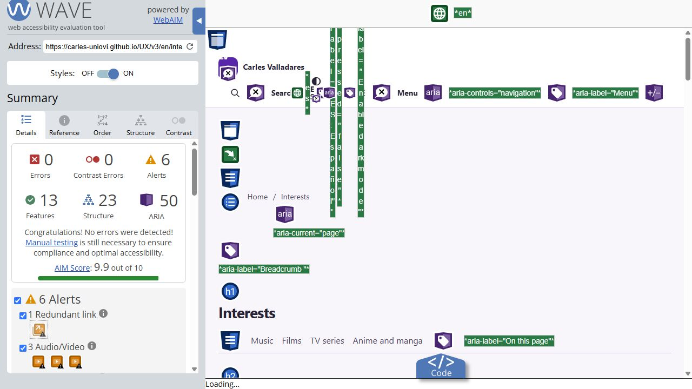
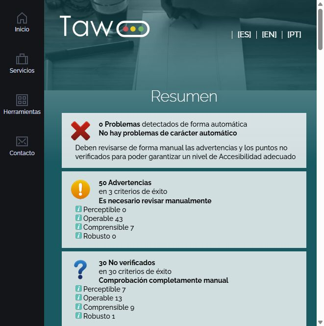
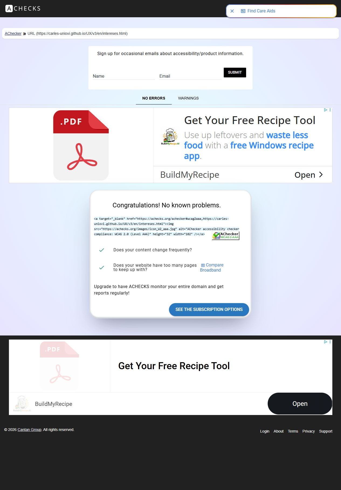

# Accesibilidad de la web personal V3

Carles Valladares García - UO319242
Experiencia de Usuario - Máster en Ingeniería Web
Fecha de revisión: 20 de noviembre de 2026

**Estado: verificación automática final completada.**

Las 18 páginas se han comprobado con TAW, AChecker y WAVE: 54 análisis finales con cero errores automáticos, incluido el contraste de WAVE. La inspección manual identifica límites de accesibilidad multimedia: los tres MP3 no tienen alternativa textual equivalente y no se acreditan todas las alternativas de los tráileres. Por ello **no se declara conformidad WCAG AAA**.

## Alcance y método

Se evaluó la dirección pública [Web personal V3](https://carles-uniovi.github.io/UX/v3/), con nueve páginas en español y sus nueve equivalentes en inglés. Se guardaron resúmenes, filas por criterio, advertencias y capturas antes y después de corregir. Los resultados se mantienen por herramienta: sus reglas y categorías son distintas.

| Herramienta | Configuración y alcance |
| --- | --- |
| TAW | Opción WCAG 2.1 AAA. El resumen devuelto contiene 61 filas de criterios y 30 no verificados por página. Se conservan sus problemas y advertencias; el resumen declara tecnologías HTML/CSS. |
| AChecker | AChecker+ de ACHECKS, opción WCAG 2.0 AAA Markup. Se revisan errores conocidos y advertencias del marcado. |
| WAVE | Servicio web con estilos activos. Se separan errores, errores de contraste y alertas; no ofrece un selector que certifique AAA. |

Las capturas registran fecha UTC. Se respetaron los límites gratuitos de TAW (intervalo de 20 segundos y 10 peticiones por hora); los mensajes de límite se guardaron y no se contaron como análisis sin problemas. El detalle H48 se solicitó por correo con autorización del autor y se incorporó el apartado que facilitó.

Se comprobó por HTTP que los 18 HTML y cuatro recursos CSS/JavaScript publicados coinciden con las fuentes revisadas, normalizando solo los saltos CRLF/LF. El registro de URL, fecha y hashes está en `manual/fuentes-publicadas.json`. Los resultados de cada herramienta tienen su propia fecha de captura.

La revisión manual combina inspección del contenido, código y árbol accesible con recorridos de teclado y mediciones de apoyo en Chrome. No es una nueva tanda con participantes ni una evaluación realizada por personas con discapacidad o con un lector de pantalla específico.

## Resultados por herramienta y página

| Herramienta | Errores iniciales | Errores finales | Avisos inicial / final |
| --- | --- | --- | --- |
| TAW | 37 | 0 | 340 / 308 |
| AChecker | 0 | 0 | 1243 / 1203 |
| WAVE | 0 | 0 | 120 / 44 |

Los recuentos son **ocurrencias por página**, no defectos únicos. Por ejemplo, una misma canción aparece en Intereses y Lectura y en ambos idiomas. Los 30 no verificados de TAW representan criterios repetidos en cada página, no 540 problemas confirmados.

| Página | TAW errores inicial / final | TAW avisos final | AC errores final | AC avisos inicial / final | WAVE error / contraste final | WAVE alertas inicial / final |
| --- | --- | --- | --- | --- | --- | --- |
| ES Inicio | 0 / 0 | 8 | 0 | 45 / 45 | 0 / 0 | 4 / 2 |
| EN Inicio | 0 / 0 | 8 | 0 | 46 / 46 | 0 / 0 | 4 / 2 |
| ES Trayectoria | 0 / 0 | 14 | 0 | 61 / 58 | 0 / 0 | 6 / 1 |
| EN Trayectoria | 0 / 0 | 14 | 0 | 62 / 59 | 0 / 0 | 6 / 1 |
| ES Aficiones | 0 / 0 | 21 | 0 | 92 / 84 | 0 / 0 | 11 / 1 |
| EN Aficiones | 0 / 0 | 21 | 0 | 93 / 85 | 0 / 0 | 11 / 1 |
| ES Intereses | 2 / 0 | 30 | 0 | 111 / 102 | 0 / 0 | 17 / 6 |
| EN Intereses | 3 / 0 | 30 | 0 | 112 / 103 | 0 / 0 | 17 / 6 |
| ES Contacto | 1 / 0 | 9 | 0 | 39 / 39 | 0 / 0 | 3 / 1 |
| EN Contacto | 0 / 0 | 9 | 0 | 40 / 40 | 0 / 0 | 3 / 1 |
| ES Ayuda | 0 / 0 | 3 | 0 | 34 / 34 | 0 / 0 | 3 / 1 |
| EN Ayuda | 0 / 0 | 3 | 0 | 35 / 35 | 0 / 0 | 3 / 1 |
| ES Mapa | 0 / 0 | 8 | 0 | 79 / 79 | 0 / 0 | 4 / 2 |
| EN Mapa | 0 / 0 | 8 | 0 | 80 / 80 | 0 / 0 | 4 / 2 |
| ES Buscador | 3 / 0 | 11 | 0 | 53 / 53 | 0 / 0 | 4 / 2 |
| EN Buscador | 3 / 0 | 11 | 0 | 54 / 54 | 0 / 0 | 4 / 2 |
| ES Lectura | 12 / 0 | 50 | 0 | 103 / 103 | 0 / 0 | 8 / 6 |
| EN Lectura | 13 / 0 | 50 | 0 | 104 / 104 | 0 / 0 | 8 / 6 |

En todas las páginas TAW mantiene 30 criterios no verificados, estudiados en el apartado de revisión manual. Datos completos, fechas y archivos de origen: `docs/accesibilidad/resultados.json` y `resultados.csv`.

## Problemas corregidos y falsos positivos

| Hallazgo | Decisión y verificación |
| --- | --- |
| Enlaces indistinguibles (2.4.9) | Los dos tráileres incluyen la película en el texto. Los saltos Leer se distinguen de la navegación general y Buscar correo se distingue de Contacto. Se comprobaron destinos y nombres en ambos idiomas. |
| Lista vacía del buscador (1.3.1) | El contenedor inicial ya no presenta una lista sin resultados. La lista ordenada se crea al obtener coincidencias y se retira al vaciar o no encontrar. |
| Prosa inglesa interpretada como lista (H48) | El detalle TAW indicaba simulación de lista ordenada mediante párrafos. Las descripciones son relatos independientes, sin una secuencia de pasos. Se mantienen sus encabezados y párrafos y se reformulan los inicios con I. La posible lectura de I como numeración romana es una inferencia; no se atribuye a un acceso al código interno de TAW. |
| Idioma de Contacto ES (3.1.1) | La página ya tenía lang=es. Se verificó el contenido real y se añadieron instrucciones claras de correo en ambos idiomas. La nueva prueba devuelve cero sin alterar el idioma correcto. |
| Lectura duplicada de imágenes y controles | Los títulos ya identifican tarjetas y universidades: sus ilustraciones y logotipos se marcan como decorativos. Se retiran títulos redundantes de Buscar/Menú; la foto conserva alternativa informativa. |
| Líneas de lectura demasiado largas (1.4.8) | La medida real detectó máximos de 89 y 87 caracteres. El ancho pasa a 60ch y los máximos medidos son 75 y 73, con interlineado y espaciado comprobados. |
| Abreviaturas e instrucciones | Se desarrollan HTML y CSS en el contenido de proyecto/lectura, se explican EN/ES en Ayuda y el tema se identifica por su función, sin depender solo de la forma circular. |

La técnica [H48 del W3C](https://www.w3.org/WAI/WCAG21/Techniques/html/H48) se aplica cuando el contenido representa una lista. Convertir estas descripciones en pasos numerados habría introducido una relación que no tienen. Se conserva el detalle recibido en `manual/detalle-h48-taw.txt` y los informes originales para contrastarlo.

Después de cada cambio pertinente se repitieron las páginas afectadas. Las mediciones de apoyo comprueban 21 casos del buscador, 18 casos de interfaz/accesibilidad, 144 combinaciones de página y tamaño y 36 análisis axe en claro/oscuro, sin infracciones automáticas. Nu Checker local valida los 18 HTML sin errores ni advertencias; css-tree no detecta errores en la gramática comprobada. Estos resultados complementan las tres herramientas exigidas.

## Estudio de advertencias de TAW

| Criterio | N | Causa posible y comprobación |
| --- | --- | --- |
| 1.1.1 | 42 | Se revisaron propósito, alternativas y redundancia: foto del gato informativa; ilustraciones y logotipos con alt vacío y contenido equivalente en texto adyacente. |
| 2.4.2 | 18 | Se comprobaron los 18 títulos y su correspondencia con sección, autor e idioma. TAW no puede decidir por sí solo si describen bien el contenido. |
| 2.4.6 | 198 | Se revisaron jerarquía y significado de encabezados y etiquetas, además de su asociación con campos y regiones. No se usan solo para aumentar el tamaño. |
| 3.2.5 | 34 | Los cambios de página, pestaña o diálogo requieren activación del usuario. Los enlaces externos avisan de la nueva pestaña y el cierre del diálogo restaura el foco. |
| 3.3.1 | 4 | El buscador admite consulta vacía, identifica la ausencia de coincidencias y anuncia el resultado con texto. No se exige un dato obligatorio sin explicación. |
| 3.3.3 | 2 | Para recuperar una búsqueda se ofrecen palabra más general, revisión de escritura, ejemplos, Limpiar y mapa. Se verificó una consulta sin coincidencias. |
| 3.3.4 | 6 | No hay operaciones legales, financieras ni cambios de registros. Las consultas GET y la copia de una dirección no son una transacción irreversible de la aplicación. |
| 3.3.5 | 2 | Campo con etiqueta y ayuda asociada; ejemplos próximos, mensajes de estado y preguntas de ayuda contextual para búsqueda y copia. |
| 3.3.6 | 2 | No hay altas, borrados o envíos de datos de aplicación que necesiten confirmación. El sitio no envía mensajes al pulsar Copiar ni ejecuta transacciones. |

Estas advertencias solicitan juicio sobre el significado o contexto. Se considera resuelto el examen cuando la comprobación documentada descarta la barrera o identifica una actuación pendiente; no se cambia el recuento bruto de la herramienta para reflejar esa valoración.

## Estudio de alertas de WAVE

| Alerta | N | Estudio y actuación |
| --- | --- | --- |
| Redundant link | 22 | La marca y el menú llevan al inicio; portada y mapa ofrecen accesos adicionales al mismo destino. La redundancia se revisa como decisión de navegación, no como un fallo automático. Se conservan los accesos útiles. |
| Noscript element | 2 | El buscador tiene una alternativa para quien no ejecuta JavaScript. Se comprobó que conduce al mapa y a Lectura y que el contenido continúa disponible. |
| Audio/Video | 12 | Los tres MP3 requieren revisar controles y alternativa textual. Los controles propios se verificaron; la ausencia de transcripción es un problema confirmado. |
| YouTube video | 8 | Se revisaron el diálogo, nombre, ausencia de autoplay, salida y enlace alternativo. Las alternativas del contenido del vídeo no quedan acreditadas por el mero uso de YouTube. |

Las alertas de texto alternativo redundante y títulos redundantes disminuyen tras la corrección. Las restantes alertas se conservan con su motivo. La [ayuda de WAVE](https://wave.webaim.org/help) distingue sus indicadores de una declaración de conformidad y exige evaluación humana para el contenido que no puede juzgar automáticamente.

## Estudio de advertencias de AChecker

Las advertencias se agrupan por comprobación. Las opciones PASS/FAIL que aparecen en el informe de ACHECKS son criterios de decisión para el evaluador; no se cuentan como aprobaciones o fallos elegidos. Los errores conocidos se mantienen separados de las advertencias.

| Comprobación exacta del servicio | N | Revisión |
| --- | --- | --- |
| <title> might not describe the document. | 18 | A01 - Comprobado |
| <script> user interface may not be accessible. | 42 | A02 - Comprobado |
| <script> may cause screen flicker. | 42 | A02 - Comprobado |
| <script> may use color alone. | 42 | A02 - Comprobado |
| Visual lists may not be properly marked. | 18 | A03 - Corregido / revisado |
| Unicode right-to-left marks or left-to-right marks may be required. | 18 | A04 - No aplica |
| <dir> attribute may be required to identify changes in text direction. | 18 | A04 - No aplica |
| Text may refer to items by shape, size, or relative position alone. | 18 | A05 - Comprobado |
| Document may be missing a "skip to content" link. | 18 | A06 - Comprobado |
| Groups of links with a related purpose are not marked. | 18 | A07 - Comprobado |
| Words or phrases that are not in the document's primary language may not be identified. | 9 | A08 - Comprobado |
| Site missing site map. | 18 | A09 - Comprobado |
| Repeated components may not appear in the same relative order each time they appear. | 18 | A10 - Comprobado |
| Long quotations may not be marked using the <blockquote> element. | 18 | A11 - No aplica |
| Link text may not be meaningful. | 452 | A12 - Corregido / revisado |
| <h1> may be used for formatting. | 18 | A13 - Comprobado |
| <h2> may be used for formatting. | 54 | A13 - Comprobado |
| Tab order may not follow logical order. | 2 | A14 - Comprobado |
| Form submission error messages may not identify empty required fields. | 2 | A15 - Comprobado |
| All required <form> fields may not be indicated as required. | 2 | A16 - No aplica |
| Form submission error messages may not provide assistance. | 2 | A15 - Comprobado |
| Form submission data may not be presented to the user before final acceptance of an irreversable transaction. | 2 | A17 - No aplica |
| Form may delete information without allowing for recovery. | 2 | A17 - No aplica |
| <input> possibly using color alone. | 2 | A18 - Comprobado |
| <label> may not describe its associated control. | 2 | A19 - Comprobado |
|  element may require a long description. | 42 | A20 - Comprobado |
| Alt text does not convey the same information as the image. | 42 | A20 - Comprobado |
| Image may contain text that is not in Alt text. | 42 | A20 - Comprobado |
| Image may be using color alone. | 42 | A20 - Comprobado |
| Image may contain text with poor contrast. | 42 | A20 - Comprobado |
| <h3> may be used for formatting. | 80 | A13 - Comprobado |
| Alt text is not empty and image may be decorative. | 2 | A21 - Comprobado |
| Sound file may be missing text transcript. | 12 | A22 - Problema confirmado |
| <h4> may be used for formatting. | 44 | A13 - Comprobado |

## Dictámenes de los grupos de AChecker

**A01 - Comprobado.** Los títulos identifican al autor y la sección; su contenido e idioma coinciden con cada página.

**A02 - Comprobado.** Se verificaron teclado, foco, mensajes y ausencia de reproducción o movimiento automático en la interfaz propia.

**A03 - Corregido / revisado.** Las listas de enlaces conservan marcado. La lista de resultados se crea solo cuando hay coincidencias; el aviso H48 de prosa se contrastó aparte.

**A04 - No aplica.** El contenido funcional ES/EN usa escritura de izquierda a derecha; no se detectaron pasajes bidireccionales que requieran cambios.

**A05 - Comprobado.** Los controles se identifican por nombre o función; el teclado ofrece alternativas a las referencias visuales.

**A06 - Comprobado.** Existe un primer enlace Saltar al contenido y se comprobó el foco en main#contenido.

**A07 - Comprobado.** Navegaciones con nombre, índices y listas permiten interpretar los grupos por su estructura y propósito.

**A08 - Comprobado.** Se revisaron lang ES/EN, saludo ca y nombres propios. Los nombres de obras no se tratan como párrafos sin marcar.

**A09 - Comprobado.** El mapa existe y se enlaza en el pie de las 18 páginas; los destinos se verifican localmente y en navegador.

**A10 - Comprobado.** La plantilla conserva orden y posición relativos de navegación y pie en los dos idiomas.

**A11 - No aplica.** No se identifican bloques de citas extensas usados como texto del perfil; títulos de obras y nombres no son citas en bloque.

**A12 - Corregido / revisado.** Tráileres, saltos Leer y ejemplo Buscar correo ya distinguen sus destinos. Se inspeccionaron el propósito y el contexto de los restantes enlaces.

**A13 - Comprobado.** Un h1 por página; h2/h3 organizan categorías y tarjetas; Lectura utiliza también h4. Se revisaron jerarquía y significado.

**A14 - Comprobado.** El resumen recibe foco al enviar y el siguiente Tab llega al primer resultado. No hay tabindex positivo.

**A15 - Comprobado.** Se revisaron consulta vacía, sin coincidencias y recuperación. Se identifica el estado y se ofrecen ejemplos y mapa.

**A16 - No aplica.** No se exige un campo obligatorio para buscar. La consulta vacía tiene orientación y alternativas.

**A17 - No aplica.** El buscador no realiza transacciones ni modifica registros: consulta texto y conserva q en la URL.

**A18 - Comprobado.** Consulta y estados se comunican con texto; no dependen solo de un cambio de color.

**A19 - Comprobado.** La pregunta visible está asociada a query mediante for; aria-describedby enlaza la ayuda.

**A20 - Comprobado.** Se inspeccionaron imágenes y texto adyacente. Ilustraciones y logotipos son decorativos para la tarea; la información del perfil permanece en HTML.

**A21 - Comprobado.** Corresponde a la foto del gato en portada: se mantiene una alternativa informativa, sin presentarla como fotografía del autor.

**A22 - Problema confirmado.** Falta alternativa textual de los tres MP3. El mismo recurso aparece en Intereses y Lectura; las 12 ocurrencias no son 12 canciones.

## Comprobación manual de los 30 no verificados

Se inspecciona cada criterio con un dictamen y una razón. Favorable se refiere a la interfaz y contenido comprobados en este entorno. Los límites de medios externos se explicitan; no se sustituyen por un aprobado general. Las evidencias concretas por fila constan en `revision-manual.json`.

| Criterio | Dictamen | Comprobación y motivo |
| --- | --- | --- |
| 1.3.3 Características sensoriales | Favorable | Buscar y Menú tienen texto. Las instrucciones del tema identifican la función del botón; los reproductores se cierran también con Escape. Las tareas no dependen solo de forma, posición o sonido. |
| 1.4.1 Uso del color | Favorable | Página actual con aria-current y marca visual; copia con mensaje escrito; resultados con contador; tema con nombre y estado. El color no es el único indicador. |
| 1.4.3 Contraste mínimo | Favorable en la paleta comprobada | Texto principal, secundario y enlaces sobre fondos utilizados: mínimo calculado 7,34:1 en ambos temas. Se inspeccionaron controles e iconos; los textos informativos no dependen de imágenes. |
| 1.4.5 Imágenes de texto | Favorable | Títulos, navegación, datos y contactos son texto HTML. Carteles e ilustraciones son decorativos respecto al contenido de sus tarjetas; los nombres de obras y universidades aparecen en texto adyacente. |
| 1.4.6 Contraste mejorado | Favorable en la paleta comprobada | La paleta textual calculada supera 7:1. Las comprobaciones de claro y oscuro y la inspección del símbolo de tema completan los avisos de contraste que no interpreta automáticamente axe. |
| 1.4.8 Presentación visual | Corregido y comprobado | Lectura pasa de 89/87 a un máximo medido de 75/73 caracteres por línea (ES/EN, Chrome 1366 px). Usa 60ch, interlineado 26,4 px para fuente de 16 px, margen de párrafo de 40 px y alineación inicial. Se verificaron ampliación/reflujo y colores forzados del usuario. |
| 1.4.9 Imágenes de texto sin excepciones | Favorable para información propia | La información del perfil está en HTML. Los carteles no sustituyen sus títulos y descripciones. Los logotipos repiten nombres escritos; no se utilizan como controles ni como única identificación. |
| 2.1.1 Teclado | Favorable en interfaz propia | Se recorrieron búsqueda, copia, ayuda, menú y diálogo con Enter/Tab/Escape. El control completo del reproductor externo de YouTube queda fuera de la comprobación realizada. |
| 2.1.2 Sin bloqueos de teclado | Favorable en interfaz propia | Escape cierra menú y reproductor y devuelve el foco al control de apertura. El confinamiento de foco del diálogo es temporal y tiene salida explícita. No se acreditan todos los estados internos de YouTube. |
| 2.2.1 Tiempo ajustable | No aplica a límites de actividad | La web no impone tiempo para leer o buscar. El botón Copiado recupera su nombre tras 2,5 s, pero la confirmación escrita permanece y la copia no caduca. |
| 2.2.2 Pausar, detener u ocultar | Favorable en interfaz propia | No hay carruseles ni movimiento automático. Audio y vídeo se abren por acción explícita, sin autoplay; el cierre del diálogo detiene o descarga el medio. |
| 2.2.3 Sin límite temporal | No aplica a actividades temporizadas | No hay cuestionarios temporizados, caducidad de búsquedas ni sesiones de usuario de la aplicación. Los medios conservan sus controles de reproducción. |
| 2.2.5 Nueva autenticación | No aplica | El sitio es público y no exige iniciar sesión. No existen datos de aplicación que se pierdan por caducidad de autenticación. |
| 2.3.1 Umbral de tres destellos | Favorable en interfaz; multimedia sin acreditar | No se encontraron destellos en el contenido propio ni animaciones automáticas. No se ha analizado fotograma a fotograma el contenido de los tráileres externos. |
| 2.3.2 Tres destellos | Favorable en interfaz; multimedia sin acreditar | La interfaz no genera secuencias de destellos. El cambio de tema es una acción del usuario. La comprobación completa del vídeo externo permanece como límite del estudio. |
| 2.4.1 Evitar bloques | Favorable | El primer enlace salta a #contenido y desplaza el foco al elemento main. Hay encabezados y regiones de navegación, además de la versión de lectura. |
| 2.4.3 Orden del foco | Favorable | Orden coherente con cabecera, contenido y pie; sin tabindex positivo. Al enviar la búsqueda el foco llega al resumen y el siguiente Tab al primer resultado. Se verificó el retorno al cerrar el diálogo. |
| 2.4.5 Múltiples vías | Favorable | Los contenidos pueden localizarse por menú, mapa, buscador, índices por categoría y versión de lectura. Se conservan los destinos de las tres tareas de usabilidad. |
| 2.4.7 Foco visible | Favorable | Contorno de 3 px y contraste de paleta. La altura real de cabecera protege los destinos; a 320 px Escape devuelve el foco visible al botón Menú. |
| 2.4.8 Ubicación | Favorable | Cada página tiene h1 y página actual identificada. Las interiores muestran migas; la lectura tiene índice por secciones. Los saltos Leer se distinguen de los enlaces a otras páginas. |
| 3.1.2 Idioma de las partes | Favorable en contenido inspeccionado | ES/EN tienen lang correcto y el saludo valenciano lleva lang=ca. Los nombres propios de obras, artistas y universidades se conservan; no se confunden con pasajes de prosa sin marcar. |
| 3.1.3 Palabras inusuales | Revisado, sin uso ambiguo observado | Se revisaron términos del perfil y de aficiones en su contexto. Dungeons & Dragons aparece desarrollado y las tecnologías reciben explicación. No se identificó una palabra usada con significado restringido o distinto del habitual. |
| 3.1.4 Abreviaturas | Mejorado y comprobado | HTML y CSS incluyen desarrollo y explicación visibles; EN/ES se explican en Ayuda. Los nombres completos de las universidades aparecen junto a sus siglas. Los nombres de artistas no se presentan como abreviaturas técnicas. |
| 3.1.5 Nivel de lectura | Revisado, sin barrera observada | Párrafos breves y vocabulario directo; se simplifican descripciones inglesas y se explican siglas. Es una inspección de lenguaje, sin atribuir un grado escolar medido ni una nueva prueba de comprensión con participantes. |
| 3.1.6 Pronunciación | No aplica a ambigüedad detectada | No se identificaron palabras cuyo significado dependa de conocer una pronunciación específica. Los nombres propios no se usan para distinguir instrucciones homógrafas. |
| 3.2.1 Al recibir el foco | Favorable | Enfocar no navega ni reproduce medios. La apertura de menú o diálogo requiere activación; los enlaces externos avisan de la nueva pestaña. |
| 3.2.2 Al introducir datos | Favorable | Escribir actualiza resultados en la misma página y conserva el foco. Enter/Buscar llevan al resumen por solicitud explícita. Limpiar borra la consulta y devuelve el foco al campo. |
| 3.2.3 Navegación consistente | Favorable | Las 18 páginas conservan las mismas posiciones y secuencia de navegación y pie. Las traducciones mantienen páginas equivalentes y el menú móvil conserva el orden del DOM. |
| 3.2.4 Identificación consistente | Favorable | Buscar, Menú, Copiar, Limpiar y Cerrar identifican la misma función en todas las páginas; los equivalentes ingleses son coherentes. El nombre del tema refleja la acción disponible. |
| 4.1.2 Nombre, función y valor | Favorable en componentes propios | Se inspeccionaron enlaces, botones, campo de búsqueda, estado de menú/tema, regiones de confirmación y diálogo con nombre. La interfaz interna de terceros no se presenta como certificada. |

## Estados y evidencias complementarias

- Copia real de correo con confirmación junto a la dirección; consulta judo con Enter, foco en resumen, Tab al primer resultado y llegada al apartado sin quedar bajo la cabecera.

- Salto al contenido, apertura de ayuda con Enter, audio sin autoplay y cierre por Escape con retorno al enlace; cierre y descarga del iframe de vídeo.

- Menú a 320 px con Escape y retorno de foco; cambio de tema con nombre de acción y estado actualizados. Los tamaños son simulados en navegador, no dispositivos físicos nuevos.

- Lectura: 60ch, interlineado 1,65, separación de párrafos de 2,5em y alineación inicial. Medidas con fuente de 16 px: 26,4 px de línea y 40 px de margen. Colores forzados y ampliación/reflujo comprobados como apoyo técnico.

## Multimedia y alcance de la conclusión

**Problema confirmado: faltan alternativas textuales equivalentes de tres audios.** Identificar artista y canción no permite conocer toda la información sonora. Las advertencias de AChecker sobre transcripción y las alertas multimedia de WAVE se consideran pertinentes, aunque sus contadores de errores sean cero.

TAW devuelve no aplicable en criterios multimedia como 1.2.1 y 1.2.2 en el resumen de Lectura, aunque existen enlaces que abren esos medios. El resumen automático no acredita su accesibilidad: la inspección de los recursos y reproductores descubre requisitos que el analizador no ha verificado.

| Recurso | Resultado y actuación necesaria |
| --- | --- |
| Robe - Del Tiempo Perdido | MP3 sin transcripción enlazada. Preparar y verificar alternativa textual equivalente. |
| Gavina.mp3 - SOTA EL CEL | MP3 sin transcripción enlazada. Preparar y verificar alternativa textual equivalente. |
| Las Petunias - Marcelo Criminal | MP3 sin transcripción enlazada. Preparar y verificar alternativa textual equivalente. |
| Spider-Man: Into the Spider-Verse | El reproductor, con el vídeo cargado y en reproducción, indica que no tiene subtítulos. Proporcionar una versión con subtítulos verificados y las demás alternativas exigibles. |
| Scott Pilgrim vs. the World | Se activaron subtítulos en inglés generados automáticamente. Su presencia no acredita exactitud, descripción de sonidos ni equivalencia en español. Revisarlos y proporcionar alternativas verificadas. |

El [criterio 1.2.1](https://www.w3.org/WAI/WCAG21/Understanding/audio-only-and-video-only-prerecorded.html) exige una alternativa equivalente para audio pregrabado. En vídeo, [1.2.6](https://www.w3.org/WAI/WCAG21/Understanding/sign-language-prerecorded.html) y [1.2.8](https://www.w3.org/WAI/WCAG21/Understanding/media-alternative-prerecorded.html) añaden requisitos AAA de interpretación y alternativa completa. No se han acreditado audiodescripción, interpretación en lengua de signos ni alternativa textual completa de estos tráileres. La presencia de un reproductor o un parámetro para solicitar subtítulos no acredita esos contenidos. Los estados observados se guardan en `manual/11-video-subtitulos.txt` y `manual/12-video-subtitulos.txt`.

La medida y corrección de lectura se interpretan según [1.4.8](https://www.w3.org/WAI/WCAG21/Understanding/visual-presentation.html). Se comprobó la presentación propia y que el navegador pudiera aplicar colores de usuario. No se atribuye a este ensayo compatibilidad con toda combinación posible de navegador y tecnología de apoyo.

**Conclusión:** se alcanza cero errores automáticos en las tres herramientas para las páginas ensayadas, y queda documentada la revisión de advertencias y criterios manuales. Las alternativas multimedia pendientes impiden declarar conformidad integral AAA. Se preservan los datos originales, los avisos y sus límites para incorporarlos al informe del sitio web personal.

## Evidencias y reproducción

La carpeta `docs/accesibilidad/inicial` contiene los 54 informes previos; `final` conserva los 54 informes de comprobación. `resultados.json` y `resultados.csv` incluyen fechas, URL, recuentos, criterios y hash de cada captura. `revision-manual.json` contiene los dictámenes y sus fuentes.

- `scripts/summarize-accessibility.py` reconstruye los recuentos de las capturas guardadas. Rechaza un resumen incompleto o un mensaje de límite en lugar de interpretarlo como cero.

- `scripts/build-accessibility-report.py` genera este capítulo y el PDF desde esos datos. Su modo final exige los 54 resultados sin errores automáticos; el modo de borrador permite revisar la maquetación antes de cerrar una repetición pendiente.

- `scripts/check.py`, `scripts/test-search.cjs`, `scripts/test-ui.cjs`, `scripts/test-search-browser.cjs` y `scripts/test-final-browser.cjs` proporcionan comprobaciones locales adicionales. Los resultados de estas pruebas no se presentan como ejecuciones de TAW, AChecker o WAVE.

Fuentes de herramientas: [TAW](https://www.tawdis.net/), [AChecker+](https://achecks.org/achecker), [documentación AChecker](https://achecks.org/documentation/frame_content.php?p=checker%2Findex.php), [WAVE](https://wave.webaim.org/). Se registran los estándares elegidos; las interfaces no exponen una versión numérica completa de sus motores.

